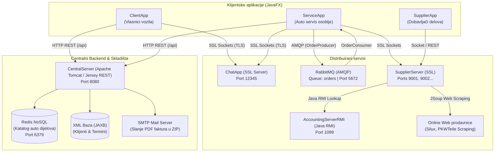

# 🚗 Vehicle Service Management System (Auto Servis Sistem)


Sveobuhvatni, distribuirani informacioni sistem za upravljanje radom auto servisa, razvijen u okviru predmeta **Mrežne i distribuirane aplikacije (MDP)** na **Elektrotehničkom fakultetu Univerziteta u Banjoj Luci (ETF BL)**.

Sistem demonstrira primjenu modernih mrežnih i distribuiranih tehnologija i protokola: **RESTful web servisi (Jersey)**, **sigurni višenitni SSL/TLS soketi**, **asinhrono procesiranje poruka (RabbitMQ)**, **distribuirani udaljeni poziv metoda (Java RMI)**, **NoSQL skladište (Redis)**, **XML/JAXB perzistencija**, **web scraping (JSoup)**, **dinamičko generisanje i komprimovanje faktura (PDF/ZIP)**, kao i **automatsko obavještavanje klijenata putem email-a (SMTP)**.

---

## 🏗️ Arhitektura sistema

Sistem je organizovan po višetipnoj, modularnoj distribuiranoj arhitekturi gde svaka komponenta obavlja specifičnu poslovnu ulogu i komunicira prilagođenim mrežnim protokolom:



---

## 📦 Ključne komponente i podsistemi

| Modul | Tehnologija / Uloga | Opis |
| :--- | :--- | :--- |
| **`CentralServer`** | JAX-RS (Jersey), Tomcat, JAXB, Jedis | Centralni REST API. Upravlja klijentima, terminima, auto dijelovima, generisanjem i slanjem računa (PDF/ZIP/Email). |
| **`ClientApp`** | JavaFX, FXML, REST klijent, SSL klijent | Desktop aplikacija za korisnike/vlasnike automobila: registracija vozila, zakazivanje servisa, istorija pregleda, podrška uživo. |
| **`ServiceApp`** | JavaFX, FXML, REST klijent, SSL, AMQP | Glavna administratorska aplikacija za osoblje servisa: evidencija klijenata, odobravanje termina, fakturisanje, poručivanje dijelova, rad sa zalihama. |
| **`SupplierApp`** | JavaFX, FXML, SSL klijent | Aplikacija za dobavljače auto dijelova: praćenje porudžbina iz servisa, ažuriranje cjenovnika i stanja artikala. |
| **`SupplierServer`** | Višenitni SSL Socket Server, JSoup | Samostalni server dobavljača koji opslužuje narudžbe, vrši web scraping dijelova i kontaktira računovodstveni RMI server. |
| **`AccountingServerRMI`**| Java RMI (Remote Method Invocation) | Računovodstveni server koji putem RMI interfejsa prima račune (`Receipt`) i trajno ih serijalizuje (`.ser`). |
| **`ChatApp`** | Višenitni SSL Socket Server & Klijent | Real-time chat podsistem zasnovan na `SSLSocket` i `SSLServerSocket` konekcijama sa podrškom za unicast i broadcast poruke. |
| **`MQ`** | RabbitMQ Client (AMQP protokol) | Podsistem za asinhrono slanje (`OrderProducer`) i prijem (`OrderConsumer`) narudžbi za auto dijelove u JSON formatu. |
| **`SharedModule`** | Modularni Java modul (`module-info.java`) | Zajednički DTO objekti, domenski modeli, PDF generator (`TxtToPdf`), ZIP kompresor (`ZipConvertor`), konfiguracija i loger. |
| **`resources`** | Konfiguracioni i statički fajlovi | `config.properties`, JAXB XML baze, JKS keystore, CSS stilovi, ikonice i prateći podaci. |

---

## ⚡ Funkcionalnosti sistema

### 1. Klijent (Vlasnik vozila)
- **Registracija i prijava**: Kreiranje korisničkog naloga sa detaljima o vozilu (proizvođač, model, godište, broj šasije, tip motora).
- **Zakazivanje termina**: Izbor željenog datuma, vremena i vrste usluge (mali/veliki servis, dijagnostika, popravka, zamjena guma, itd.).
- **Istorijat i status termina**: Uvid u trenutne i prethodne termine (`SCHEDULED`, `IN_PROGRESS`, `COMPLETED`, `CANCELLED`).
- **Korisnička podrška (Chat uživo)**: Direktan razgovor sa serviserom u realnom vremenu preko zaštićenog SSL kanala.

### 2. Auto Servis (Administrator / Serviser)
- **Upravljanje terminima**: Pregled rasporeda, prihvatanje, izmjena detalja, otkazivanje ili označavanje servisa završenim.
- **Upravljanje klijentima**: Pregled registrovanih korisnika, odobravanje novih naloga, privremeno blokiranje ili brisanje naloga.
- **Evidencija auto dijelova (Redis)**: Brzo dodavanje, izmjena cijena, ažuriranje zaliha i pretraga dijelova po šifri i nazivu.
- **Izdavanje faktura & Obavještavanje**:
  - Automatski obračun utrošenih dijelova, radnih sati servisa i poreza (17% PDV).
  - Kreiranje PDF fakture (Apache PDFBox) i pakovanje u ZIP arhivu.
  - Automatsko slanje fakture na email klijenta (Jakarta Mail / SMTP).
- **Poručivanje dijelova (MQ / SSL)**:
  - Slanje asinhronih narudžbi putem RabbitMQ reda `orders`.
  - Direktno slanje narudžbi dobavljačima preko zaštićenih SSL soketa.
  - Praćenje statusa poručenih artikala.

### 3. Dobavljač dijelova
- **Katalog artikala**: Dodavanje novih artikala, ručno podešavanje cijena i količina.
- **Web Scraping ponude**: Automatsko preuzimanje aktuelnih cijena i specifikacija auto dijelova sa sajtova (Silux, PKWTeile) putem JSoup parsiranja.
- **Obrada narudžbi**: Prijem narudžbi iz auto servisa, odobravanje, isporuka i automatsko slanje računa računovodstvu putem Java RMI.

### 4. Računovodstvo & Sigurnost
- **Java RMI arhiviranje**: Trajno čuvanje serijalizovanih računa (`receipt<ID>.ser`) na izdvojenom računovodstvenom serveru.
- **End-to-End SSL/TLS**: Korišćenje digitalnih sertifikata iz Java KeyStore-a (`keystore.jks`) za enkripciju čet i dobavljačkih soketa.

---

## 🛠️ Tehnološki stek i protokoli

- **Jezik & Platforma**: Java 19+ (Java SE, JPMS moduli)
- **GUI okruženje**: JavaFX 22, FXML, CSS
- **Web & Application Server**: Apache Tomcat 9.0
- **RESTful Framework**: Jersey JAX-RS 2.x / 3.x
- **NoSQL Baza**: Redis (Jedis klijent biblioteka)
- **Strukturirana perzistencija**: XML sa Jakarta XML Binding (JAXB)
- **Message Broker**: RabbitMQ (AMQP Java Client)
- **Distribuirani objekti**: Java Remote Method Invocation (RMI)
- **Sigurnost**: TLS/SSL Soketi (`SSLSocket`, `SSLServerSocket`, Java Keystore `.jks`)
- **Parsiranje weba**: JSoup HTML Parser
- **Obrada dokumenata**: Apache PDFBox 2.0 (PDF generisanje) & Java Zip API
- **Slanje pošte**: Jakarta Mail / Angus Mail (SMTP preko Gmail TLS)
- **Logovanje**: Java Util Logging (`MyLogger`) sa rotacijom logova

---

## 📁 Struktura repozitorijuma

```text
vehicle-service-management-system/
├── AccountingServerRMI/          # Java RMI server za računovodstvo i serijalizaciju računa
│   └── src/                      # RMI interfejs i implementacija servera
├── CentralServer/                # Jersey REST API aplikacija (Tomcat Web App)
│   └── src/main/
│       ├── java/                 # Kontroleri, servisi, repozitorijumi, email i testovi
│       └── webapp/WEB-INF/       # web.xml i spoljne JAR biblioteke
├── ChatApp/                      # Višenitni SSL Chat server i socket klijent
│   └── src/                      # ChatServer, ClientHandlerThread, ChatClient
├── ClientApp/                    # JavaFX aplikacija za klijente servisa
│   └── src/application/          # FXML pogledi, kontroleri, REST i Chat integracija
├── MQ/                           # RabbitMQ AMQP komunikacija
│   └── src/org/unibl/etf/mq/     # OrderProducer, OrderConsumer, ConnectionFactory
├── ServiceApp/                   # JavaFX aplikacija za radnike i administratore servisa
│   └── src/application/          # Upravljanje klijentima, delovima, terminima i fakturama
├── SharedModule/                 # Centralni deljeni modul sa modelima, DTO i pomoćnim klasama
│   └── src/                      # Modeli, DTOs, TxtToPdf, ZipConvertor, ConfigManager, MyLogger
├── SupplierApp/                  # JavaFX aplikacija za dobavljače rezervnih delova
│   └── src/application/          # Pregled kataloga, dodavanje artikala, narudžbe
├── SupplierServer/               # Višenitni SSL server za dobavljače sa Web Scrapingom
│   └── src/                      # SupplierServer, ItemScraper, SupplierService
├── resources/                    # Konfiguracija, resursi i podaci
│   ├── appointments/             # appointments.xml (perzistencija termina)
│   ├── clinets/                  # clinets.xml (perzistencija korisnika)
│   ├── config.properties         # Glavni konfiguracioni fajl sistema
│   ├── css/                      # CSS teme za korisnički interfejs
│   ├── gui_images/               # Ikonice, slike i snimci ekrana aplikacije
│   ├── items_links/              # Linkovi i fallback podaci za web scraping delova
│   ├── keystore/                 # keystore.jks (SSL sertifikati i ključevi)
│   └── suppliers/                # suppliers.txt (podaci o dostupnim dobavljačima i portovima)
├── .gitignore                    # Ignorisanje .class, metadata, privremenih i log fajlova
└── README.md                     # Dokumentacija projekta
```

---

## ⚙️ Preduslovi i konfiguracija

### 1. Softverski preduslovi
Prije pokretanja potrebno je imati instalirano:
- **Java Development Kit (JDK)**: Verzija 19 ili novija
- **JavaFX SDK**: Verzija 22 (ukoliko nije sastavni dio JDK-a)
- **Apache Tomcat**: Verzija 9.0
- **Redis Server**: Pokrenut lokalno na portu `6379`
- **RabbitMQ Server**: Pokrenut lokalno sa omogućenim AMQP portom `5672`
- **Eclipse IDE za Enterprise Java and Web Developers** (preporučeno)

### 2. Podešavanje konfiguracije (`resources/config.properties`)
U fajlu `resources/config.properties` prilagodite apsolutne putanje prema vašem lokalnom računaru:

```properties
LOGGER_PATH=./resources/logs/logger.log
CLIENTS_XML_PATH=./resources/clinets/clinets.xml
APPOINTMENTS_XML_PATH=./resources/appointments/appointments.xml
KEY_STORE_PATH=./resources/keystore/keystore.jks
KEY_STORE_PASSWORD=securemdp
CHAT_PORT=12345
CHAT_HOST=localhost
REDIS_PORT=6379
REDIS_HOST=localhost
SUPPLIERS_PATH=./resources/suppliers/suppliers.txt
SERVICE_NAME=Auto servis Balaban
HOURLY_RATE=20.0
WORKIND_HOURSE=1
MQ_HOST=localhost
MQ_USERNAME=guest
MQ_PASSWORD=guest
QUEUE_NAME=orders
RECEIPTS_PATH=./resources/receipts
ZIP_PATH=./resources/invoice
ACCOUNTING_RMI=AccountingServer
```

---

## 🚀 Uputstvo za pokretanje sistema

Kako bi svi podsistemi funkcionisali sinhronizovano, pokrenite komponente sledećim redosledom:

### Korak 1: Infrastrukturni servisi
1. **Pokrenite Redis server**:
   ```bash
   redis-server
   ```
2. **Pokrenite RabbitMQ server**:
   ```bash
   rabbitmq-server
   ```

### Korak 2: Centralni Web Server
1. Uvezite projekat `CentralServer` u Eclipse ili raspakujte `.war` u Tomcat `webapps/` direktorijum.
2. Pokrenite **Apache Tomcat v9.0** server.
3. Proverite dostupnost REST servisa na adresi: `http://localhost:8080/CentralServer/api/clients`.

### Korak 3: Pomoćni serverski podsistemi
1. **Računovodstveni RMI Server**:
   Pokrenite glavnu klasu:
   `AccountingServerRMI -> org.unibl.etf.accounting.rmi.AccountingServer`
   *(RMI registar se podiže na portu 1099)*.
2. **SSL Chat Server**:
   Pokrenite `ChatApp` servis preko instance `ChatServer.getInstance().start()`.
3. **Serverske instance dobavljača**:
   Pokrenite dobavljački server (npr. `SupplierServer -> org.unibl.etf.supplier.server.Supplier1ServerStart`).

### Korak 4: Desktop klijentske aplikacije (JavaFX)
Pokrenite željene klijentske aplikacije pokretanjem `Main` klase u odgovarajućem projektu:
1. **`ServiceApp`**: `ServiceApp/src/application/Main.java` (Aplikacija za auto servis)
2. **`SupplierApp`**: `SupplierApp/src/application/Main.java` (Aplikacija za dobavljače)
3. **`ClientApp`**: `ClientApp/src/application/Main.java` (Aplikacija za klijente)
